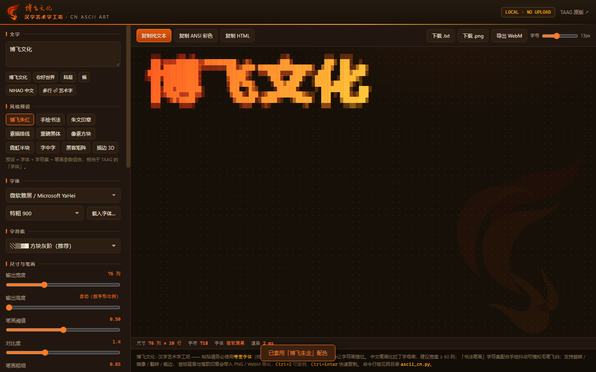

# Hanzi ASCII Art Studio · `hanzi-ascii-art`

> **Zero-dependency, offline-first ASCII art for CJK text — any character, any font, in one HTML file.**

[简体中文](README.md) · **English**



**MIT** · **single file** · **no build step** · **no backend** — an ASCII / Unicode art generator for Chinese (and, in fact, any text), built as the CJK counterpart to [patorjk TAAG](https://patorjk.com/software/taag/).

---

## Why this exists

FIGlet and TAAG work by storing **a fixed bitmap template for every character**. That is affordable for the 95 printable Latin characters; it is not for the 3,500+ characters in common Chinese usage. Every FIGlet-based tool therefore skips CJK input and outputs nothing — an architectural limitation, not a missing feature waiting to be implemented.

Tools that do claim Chinese support fall into three approaches:

| Approach | Limitation |
|---|---|
| Hand-curated glyph tables (most "Chinese ASCII art" web tools) | A hundred-odd characters stored by hand. `你好` works; your own name comes out blank. |
| Fixed bitmap font conversion (chacuo, orz6, …) | One font, a handful of knobs. Not really "art". |
| Adding CJK fonts to FIGlet (`gb16fs` and friends) | Glyphs must be pre-generated, tied to encodings such as GB2312; the character set is finite and the font cannot be changed. |

**This project takes a fourth route**: instead of enumerating Hanzi, it uses a browser Canvas to **render any installed font into a high-resolution bitmap in real time, downsample that bitmap onto a character grid, and map the resulting grey levels to characters**. Consequences:

- Any Hanzi, any system font, rare characters, mixed Chinese/Latin text, and even user-supplied TTF/OTF files all work.
- Switching fonts is the equivalent of switching FIGlet fonts, with **no glyph library to ship** (the repository contains no font binaries).
- Chinese and Latin text go through the same engine, so mixed text keeps one consistent look — unlike tools that rasterize Chinese while routing English through FIGlet.

---

## Features

Unless noted otherwise, everything below refers to the web app, `index.html`.

- **One file, zero build**: double-click `index.html`. No npm, no server, no bundler.
- **10 style presets**, **7 one-click palettes**, **10 character sets** (shade blocks / pure ASCII / solid black-and-white / half blocks / calligraphic strokes / hatching / dots / stars / binary / a custom "character-in-character" set).
- **18 font entries**: Windows CJK system fonts, 8 open-source web fonts, monospace and serif faces, plus **load-your-own font** (kept in browser memory only).
- Fine-grained controls: width, row count, threshold, contrast, gamma, stroke weight, shadow, line spacing, font weight, inversion, binarization, vertical layout, rotation, horizontal mirror, vertical flip, auto-crop, and dry-brush jitter.
- **Half-block `▀▄█` mode doubles vertical resolution**; **fullwidth compensation** keeps double-width fill characters from stretching the glyph — you can draw `福` out of `六` without distorting it.
- Rice-paper texture, a signature seal stamp, and vermilion–gold gradients all carry through to PNG / WebM export.
- **8 preview animations**. Animations affect the preview only: copy and TXT / ANSI / HTML / PNG exports always produce the complete static frame. WebM is the sole exception — it records the running animation as a looping clip.
- Outputs: plain text, ANSI truecolor, HTML, PNG, WebM. Settings persist locally; `Ctrl+Z` undoes, `Ctrl+Enter` copies.
- Two forms: a web app and a CLI.

---

## Quick start

### Web app (primary)

Just double-click `index.html`, or:

```bash
git clone https://github.com/LouisChenParfait/hanzi-ascii-art.git
cd hanzi-ascii-art
start index.html        # Windows; use `open` on macOS, `xdg-open` on Linux
```

Because the whole tool is a single static HTML file, enabling GitHub Pages (Settings → Pages → deploy from the root of `main`) turns `index.html` itself into the live demo:

```
https://louischenparfait.github.io/hanzi-ascii-art/
```

No second repository, no build pipeline. (This URL is not live until Pages is enabled.)

### Command line

```bash
pip install Pillow
python ascii_cn.py "你好世界" -f yahei -w 72 -c block
python ascii_cn.py "福" -f song -c custom --custom "六" --sharp 2
python ascii_cn.py "HELLO 中文" -f yahei -w 56 -c half --ansi --color gold
python ascii_cn.py "line one\nline two" -o banner.txt
python ascii_cn.py -l                     # list font aliases available on this machine
```

| Flag | Meaning |
|---|---|
| `-f, --font` | Font alias (see `-l`) or an absolute path to a font file |
| `-w, --width` | Output columns, default `76` |
| `-H, --height` | Output rows; `0` (default) derives it from the glyph's real proportions — recommended |
| `-c, --charset` | `block` / `ascii` / `solid` / `half` / `dots` / `stars` / `binary` / `custom` (the web app adds calligraphic strokes, hatching, etc.) |
| `--custom` | Character used as ink when `-c custom` |
| `--bold` / `--invert` | Stroke width 0–3 / invert |
| `--gamma` / `--threshold` / `--contrast` / `--sharp` | Greyscale and stroke shaping |
| `--ansi` / `--color` | Emit ANSI colour escapes, with a colour name |
| `-o, --out` | Write to a UTF-8 file |
| `-l, --list-fonts` | List available font aliases |

> **Feature parity is intentionally unequal.** The CLI is the earlier implementation: rotation, mirror / flip, auto-crop, animations, rice-paper background, seal stamp, web calligraphy fonts, and PNG / WebM export exist only in `index.html`. Use the web app when you need them.

---

## How it works, and the traps along the way

1. **Aspect-ratio compensation.** A monospace cell is visually about 1:2 (width:height), so the supersampled canvas is `cols×8 × rows×16` and each cell's average brightness comes from a `BOX` downsample. Row count must be derived from the real glyph proportions — `rows = cols × (glyph height / glyph width) × 0.5` — or Hanzi get squashed with large empty bands above and below.
2. **Half-block mode** doubles the sampled row count and halves the cell height, keeping the total canvas ratio unchanged. Vertical detail doubles without adding a single column.
3. **Fullwidth compensation.** A CJK fill character occupies two columns, so the grid width must be halved and the aspect set to 1.0; otherwise "character-in-character" output is stretched horizontally.
4. **Pick the right SimSun file.** `simsunb.ttf` is the Extension-B font and contains no everyday characters — using it renders a row of missing-glyph "tofu" boxes. The `song` alias deliberately prefers `simsun.ttc`.
5. **Dense strokes need the right ramp.** A pure-ASCII greyscale ramp turns dense Hanzi strokes into noise, which is why solid and block sets exist and why threshold / contrast / gamma are exposed as manual controls.

---

## Privacy and network requests

Please read this section in full if the word "offline" matters to you.

- The text you type and any font you load are **processed in browser memory only** and never uploaded. There is no backend, no analytics script, no cookies, no third-party JavaScript.
- Settings live in `localStorage` under `cn-ascii-state-v3`, on your machine only, with no sync.
- **The one external request**: `<head>` in `index.html` contains two Google Fonts `<link>` tags (`preconnect` and `stylesheet`). On page load the browser requests the CSS and font files for 8 open-source web fonts from `fonts.googleapis.com` / `fonts.gstatic.com`, and in doing so sends Google your IP address, User-Agent and Referer.
- So the header badge `LOCAL · NO UPLOAD` means precisely "**your text and font files are not uploaded**" — it does not mean "zero network requests". Core rendering does not depend on the CDN at all: remove those two `<link>` tags and the tool is 100% offline, with the online calligraphy options falling back to local fonts.
- Google Fonts may be unreachable or slow from mainland China. `display=swap` plus local font fallbacks keep core functionality intact, but `<link rel="stylesheet">` is render-blocking; if first-paint speed matters, deleting it is the cleanest fix.

---

## Third-party assets and licensing

| Asset | Use | License / notes |
|---|---|---|
| 8 Google Fonts families: Ma Shan Zheng, Zhi Mang Xing, Liu Jian Mao Cao, Long Cang, ZCOOL KuaiLe, ZCOOL QingKe HuangYou, Noto Serif SC, Noto Sans SC | Online font options | Open-source fonts distributed by Google Fonts, mostly under **SIL Open Font License 1.1**, free for commercial use; individual fonts may carry their own license. **Referenced via CDN only — no font binary is bundled.** |
| System fonts (Microsoft YaHei, SimHei, SimSun, KaiTi, DengXian, Microsoft JhengHei, FangSong, Consolas, Georgia, …) | CSS `font-family` names | **Not distributed with this project.** The tool calls fonts already installed on your machine; their use is governed by your OS license. |
| [Pillow](https://python-pillow.org/) | Rendering dependency of the CLI | HPND / MIT-CMU |
| [patorjk TAAG](https://patorjk.com/software/taag/) | Inspiration and point of comparison | Acknowledgement link only; **none of its font files or code is used** |

### Trademarks and brand assets

The "博飞文化" (Bofei Culture) name and the header logo (embedded as `<symbol>` in `index.html`, with design sources `vLOGO.svg` / `vWORDs.svg`) are brand assets of the project owner and are **not covered by the MIT license**. MIT covers the source code. If you fork and republish, replace these marks or obtain separate permission.

---

## Known limitations

- **The UI is currently Simplified Chinese only**; there is no i18n layer yet. Every knob is labelled in Chinese, though the underlying parameters and the CLI are language-neutral.
- Font names lean Windows-specific; macOS / Linux fall back through CSS to locally installed fonts, so glyph shapes will differ from the preview screenshot. Upload your own TTF for cross-platform consistency.
- Custom fonts live in memory only and disappear on reload — a deliberate privacy choice, not an oversight.
- Rare characters depend on whether the chosen font contains the glyph; missing glyphs show up as "tofu" boxes.
- Thin-stroke faces (KaiTi, for example) need manual threshold / contrast tuning at low column counts.
- **Paste character art only in a monospace context** (terminal, fenced code block, README). A proportional font will break alignment. CJK strokes are denser than Latin letters, so a width of ≥ 60 columns is recommended.
- WebM export depends on the browser's MediaRecorder support.
- The CLI lags behind the web app; see "Feature parity" above.

---

## Repository layout

```
hanzi-ascii-art/
├── index.html          # primary deliverable: single-file web app (CSS/JS and logo inlined)
├── ascii_cn.py         # CLI (requires Pillow)
├── docs/
│   └── preview.png     # screenshot used above
├── vLOGO.svg           # brand design sources (trademark rights reserved)
├── vWORDs.svg
├── README.md           # Simplified Chinese
├── README.en.md        # English (this file)
├── LICENSE             # MIT
└── .gitignore
```

`.workbuddy/` (local working notes), `index_backup.html` (old backup) and `_js1.js` (debug script) are local working files, excluded by `.gitignore` and never committed.

---

## Contributing

Issues and PRs are welcome. A few house rules:

- **The single file is a deliberate design constraint**: please don't introduce a build step, npm dependencies or CDN scripts.
- After changing rendering logic, run a regression pass over presets, character sets and export paths with headless Chrome + CDP. That has been this project's verification method from the start.
- Don't commit absolute local paths, personal notes, font binaries or credentials.
- Before committing, make sure no local export artefacts other than `docs/preview.png` slipped in.

---

## Credits

[patorjk TAAG](https://patorjk.com/software/taag/) and the FIGlet community defined the "text into art" category; Google Fonts and the open-source type designers made Chinese calligraphy faces freely usable; Pillow made the CLI possible. No proprietary font data or code from any of them is used here.

---

## License

Source code is licensed under the **MIT License** — see [LICENSE](LICENSE).

Copyright (c) 2026 LouisChenParfait

Brand assets (name and logo) are excluded; see "Trademarks and brand assets" above.
