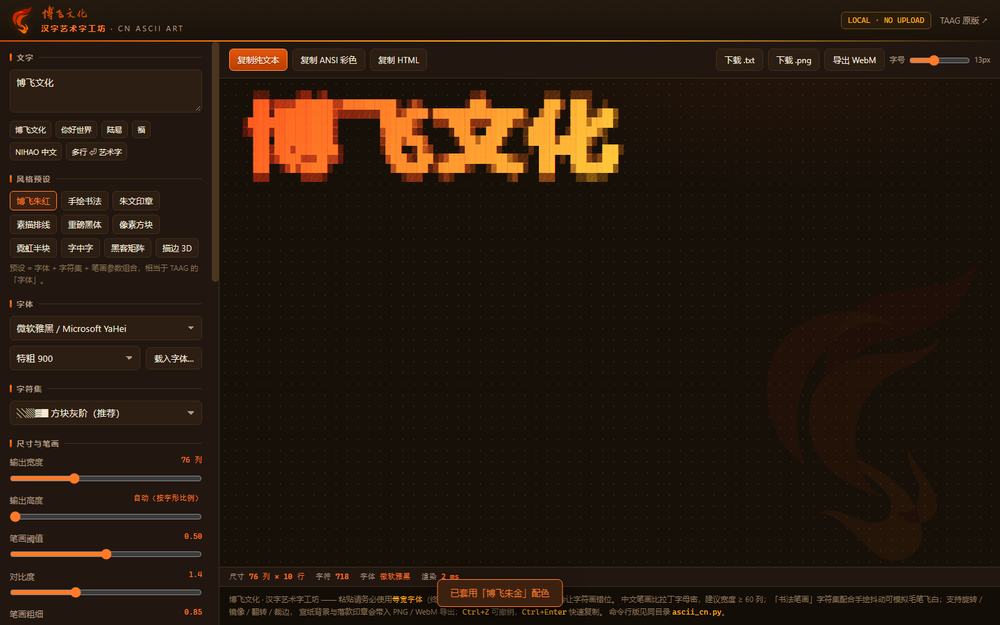

# 汉字艺术字工坊 · hanzi-ascii-art

**简体中文** · [English](README.en.md)

> **Zero-dependency, offline-first ASCII art for CJK text — any character, any font, in one HTML file.**



**MIT** · **单文件** · **零构建** · **无后端** · **[在线 Demo ↗](https://louischenparfait.github.io/hanzi-ascii-art/)** — 一个能处理中文（以及任意文字）的 ASCII / Unicode 字符画工具，对标 [patorjk TAAG](https://patorjk.com/software/taag/)，补上它做不了中文的空白。

---

## 为什么需要它

FIGlet / TAAG 的原理是**给每个字符预存一套固定点阵模板**（FIGlet 字体文件）。拉丁字符只有 95 个可打印字符，手绘得起；中文常用字 3500+，逐一预存不现实。所以所有 FIGlet 系工具遇到中文都是直接跳过、输出空白——这是架构限制，不是「还没做适配」。

现存号称支持中文的方案，基本是三种路线：

| 路线 | 局限 |
|---|---|
| 预置字表（多数「中文 ASCII 在线工具」） | 手工存了百余个汉字，打「你好」行，打自己名字就是空白 |
| 固定点阵转换（chacuo / orz6 等） | 只有一种字体、几个参数，谈不上艺术化 |
| 给 FIGlet 补中文字模（`gb16fs` 一类） | 需预生成字模、绑定 GB2312 等编码，字库有限且换不了字体 |

**本工具走第四条路**：不枚举汉字，而是用浏览器 Canvas 把任意系统字体**实时渲染成高分辨率位图 → 按字符网格降采样成灰阶 → 映射成字符**。于是：

- 任意汉字、任意系统字体、生僻字、中英混排、甚至用户自己上传的 TTF/OTF 都成立；
- 换字体就等于换 FIGlet 字体，而且**不需要打包任何字模库**（仓库里没有任何字体二进制文件）；
- 中英文由同一套引擎渲染，风格统一，不像某些工具中文走光栅化、英文走 FIGlet 两套美学。

---

## 特性

以下除特别说明外，均指网页版 `index.html`。

- **单文件零构建**：`index.html` 双击即用，无需 npm、无需后端、无需打包步骤。
- **10 套风格预设**、**7 组一键调色板**、**10 种字符集**（方块灰阶 / 纯 ASCII / 实心黑白 / 半块 / 书法笔画 / 素描排线 / 点阵 / 星芒 / 二进制 / 自定义「字中字」）。
- **18 项字体选项**：Windows 中文系统字体、8 款在线开源书法字体、等宽 / 衬线，以及**载入本机自定义字体**（仅存在于浏览器内存）。
- 精细可调：宽度、行数、阈值、对比度、gamma、描边、阴影、行距、字重、反色、二值、竖排、旋转、左右镜像、上下翻转、自动裁边、手绘飞白抖动。
- **半块 `▀▄█` 双倍纵向分辨率**；**全角字符双列补偿**——可以用「六」拼出「福」而字形不被拉扁。
- 宣纸肌理背景、落款印章、朱金渐变，均可带入 PNG / WebM 导出。
- 8 种预览动画；动画只作用于预览，复制与 TXT / ANSI / HTML / PNG 导出始终是完整静态画面，`WebM` 是唯一的例外（把当前动画录成循环视频）。
- 输出：纯文本、ANSI truecolor、HTML、PNG、WebM；参数自动保存在本机，`Ctrl+Z` 撤销，`Ctrl+Enter` 快速复制。
- Web + CLI 双形态。

---

## 快速开始

### 网页版（主交付）

双击 `index.html` 即可，或：

```bash
git clone https://github.com/LouisChenParfait/hanzi-ascii-art.git
cd hanzi-ascii-art
start index.html        # Windows；macOS 用 open，Linux 用 xdg-open
```

因为整个工具就是一个静态 HTML，仓库已启用 GitHub Pages（Settings → Pages → 从 `main` 分支根目录部署），`index.html` 本身就是在线 Demo：

```
https://louischenparfait.github.io/hanzi-ascii-art/
```

不需要第二个仓库、不需要构建流水线。

### 命令行版

```bash
pip install Pillow
python ascii_cn.py "你好世界" -f yahei -w 72 -c block
python ascii_cn.py "福" -f song -c custom --custom "六" --sharp 2
python ascii_cn.py "HELLO 中文" -f yahei -w 56 -c half --ansi --color gold
python ascii_cn.py "第一行\n第二行" -o banner.txt
python ascii_cn.py -l                     # 列出本机可用的字体别名
```

| 参数 | 作用 |
|---|---|
| `-f, --font` | 字体别名（见 `-l`）或字体文件的完整路径 |
| `-w, --width` | 输出列数，默认 76 |
| `-H, --height` | 输出行数，`0` = 按字形真实比例自动计算（推荐） |
| `-c, --charset` | 字符集：`block` / `ascii` / `solid` / `half` / `dots` / `stars` / `binary` / `custom`（网页版另有书法笔画、素描排线等） |
| `--custom` | `-c custom` 时用作笔画的字符 |
| `--bold` / `--invert` | 描边 0–3 / 反色 |
| `--gamma` / `--threshold` / `--contrast` / `--sharp` | 灰阶与笔画调节 |
| `--ansi` / `--color` | 输出 ANSI 彩色转义及颜色名 |
| `-o, --out` | 写入 UTF-8 文件 |

> **能力不对等**：命令行版是较早的实现，旋转、镜像 / 翻转、裁边、动画、宣纸背景、印章、在线书法字体、PNG / WebM 导出目前都只在网页版。需要这些请用 `index.html`。

---

## 原理与踩过的坑

1. **宽高比补偿**。等宽字符 cell 的视觉宽高比约为 1:2，所以超采样画布取 `cols×8 × rows×16`，再用 `BOX` 降采样求每格平均亮度。输出行数必须按字形真实比例算：`rows = cols × (字形高 / 字形宽) × 0.5`，否则汉字会被压扁、上下留大片空白。
2. **半块模式**把采样行数 ×2、cell 高改为 8，保持总画布比例不变，从而在不增加列数的前提下把纵向细节翻倍。
3. **全角补偿**。用全角字符（如汉字）做填充时它占两列，必须把网格列数减半并把 aspect 改为 1.0，否则「字中字」会横向拉伸。
4. **宋体要认准字库**。`simsunb.ttf` 是宋体扩展 B 字库、不含常用字，用它渲染会得到一排「缺字豆腐块」；宋体别名固定优先 `simsun.ttc`。
5. **中文笔画密**，纯 ASCII 灰阶 ramp 容易把笔画糊成噪声，所以提供方块 / 实心字符集，并把阈值、对比度、gamma 暴露出来手动调。

---

## 隐私与网络请求

这一节请完整读完，尤其当你在意「离线」二字时。

- 你输入的文字、载入的自定义字体**只在浏览器内存中处理**，不上传任何服务器。项目没有后端、没有统计脚本、没有 Cookie、没有第三方 JS。
- 参数保存在浏览器 `localStorage`（键 `cn-ascii-state-v3`），仅在本机，不会同步。
- **唯一的外部请求**：`index.html` 的 `<head>` 有两行 Google Fonts `<link>`（`preconnect` 与 `stylesheet`），页面加载时会向 `fonts.googleapis.com` / `fonts.gstatic.com` 请求 8 款在线开源字体的 CSS 与字体文件；浏览器会随之向 Google 发送 IP、User-Agent 与 Referer。
- 因此页眉徽标 `LOCAL · NO UPLOAD` 的准确含义是「**不上传你的文字与字体文件**」，不等于「零网络请求」。核心渲染完全不依赖 CDN：删掉这两行 `<link>` 后，工具 100% 离线可用，在线书法字体选项会自动回退到本机楷体 / 雅黑。
- 国内网络访问 Google Fonts 可能超时。已使用 `display=swap` 与本地字体回退，不会影响核心功能；但 `<link rel="stylesheet">` 本身是渲染阻塞资源，若很在意首屏速度，删除它是最彻底的解决办法。

---

## 第三方资源与授权

| 资源 | 用途 | 授权与说明 |
|---|---|---|
| Google Fonts 的 8 款中文书法 / 黑体字体（Ma Shan Zheng、Zhi Mang Xing、Liu Jian Mao Cao、Long Cang、ZCOOL KuaiLe、ZCOOL QingKe HuangYou、Noto Serif SC、Noto Sans SC） | 在线字体选项 | Google Fonts 平台上的字体均为开源字体，主要为 **SIL Open Font License 1.1**，免费可商用，个别字体以其自身许可证为准。本项目**仅通过 CDN 引用，不打包任何字体二进制**。 |
| 系统字体（微软雅黑、黑体、宋体、楷体、等线、微软正黑、仿宋、Consolas、Georgia 等） | CSS `font-family` 名称引用 | **不随本项目分发**。项目只调用你本机已安装的字体，其使用许可由操作系统提供，请自行遵守。 |
| [Pillow](https://python-pillow.org/) | 命令行版渲染依赖 | HPND / MIT-CMU 开源许可 |
| [patorjk TAAG](https://patorjk.com/software/taag/) | 产品灵感与对照 | 仅保留致谢链接，**未使用其字体文件或任何代码** |

### 商标与品牌资产

「博飞文化」名称与页眉 logo（内嵌在 `index.html` 的 `<symbol>` 中，设计源文件为 `vLOGO.svg` / `vWORDs.svg`）属于项目所有者的品牌资产，**不在 MIT 许可证的授权范围内**。MIT 覆盖的是源代码；如果你 fork 后重新发布，请替换这些标识，或另行取得授权。

---

## 已知限制

- 字体名偏 Windows 系；macOS / Linux 会按 CSS fallback 到本机字体，字形与预览截图不完全一致。需要跨平台一致的效果，请上传自己的 TTF。
- 自定义字体只存在于内存，刷新页面即失效——这是刻意的隐私取舍，不做持久化。
- 生僻字能否显示取决于所用字体是否包含该字形；字体缺字时会显示「豆腐块」。
- 细笔画字体（楷体等）在低列数下需要手动调阈值 / 对比度。
- **粘贴字符画必须使用等宽字体**（终端、代码块、README），比例字体会让字符画错位；中文笔画比拉丁字母密，建议宽度 ≥ 60 列。
- WebM 导出依赖浏览器对 MediaRecorder 的支持。
- 命令行版能力落后于网页版，见上文「能力不对等」。

---

## 目录结构

```
hanzi-ascii-art/
├── index.html          # 主交付：单文件网页工具（CSS/JS 与 logo 全部内嵌）
├── ascii_cn.py         # 命令行版（需要 Pillow）
├── docs/
│   └── preview.png     # 效果预览截图
├── vLOGO.svg           # 品牌标识设计源文件（商标权利保留）
├── vWORDs.svg
├── README.md           # 简体中文
├── README.en.md        # English
├── LICENSE             # MIT
└── .gitignore
```

`.workbuddy/`（本地工作笔记）、`index_backup.html`（旧版备份）、`_js1.js`（调试脚本）属于本地工作文件，已由 `.gitignore` 排除，不会进入仓库。

---

## 贡献

欢迎 Issue 与 PR。几点约定：

- **单文件是刻意的设计约束**：请勿引入构建步骤、npm 依赖或 CDN 脚本。
- 改动渲染逻辑后，建议用无头 Chrome + CDP 遍历预设、字符集与导出链路做回归；本项目一直是这样验证的。
- 请勿提交本机绝对路径、个人笔记、字体二进制或密钥。
- 提交前请确认 `docs/preview.png` 之外没有把本地导出物带进仓库。

---

## 致谢

[patorjk TAAG](https://patorjk.com/software/taag/) 与 FIGlet 社区定义了「文字变艺术字」这个品类；Google Fonts 与各开源字体作者让中文书法字体可以被自由使用；Pillow 让命令行版得以成立。本项目未使用上述任一项目的专有字库或代码。

---

## 许可证

本项目源代码采用 **MIT License**，详见 [LICENSE](LICENSE)。

Copyright (c) 2026 LouisChenParfait

品牌资产（名称与 logo）不在授权范围内，见上文「商标与品牌资产」。
